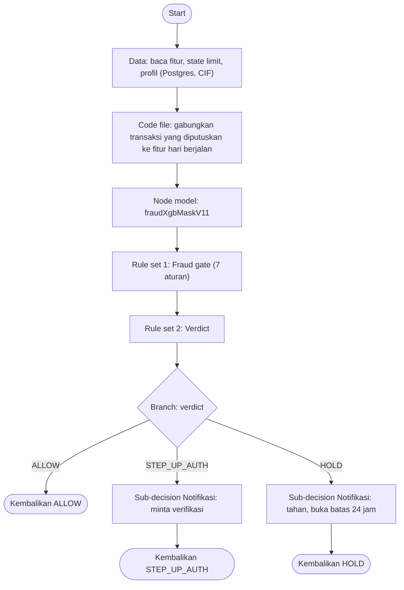
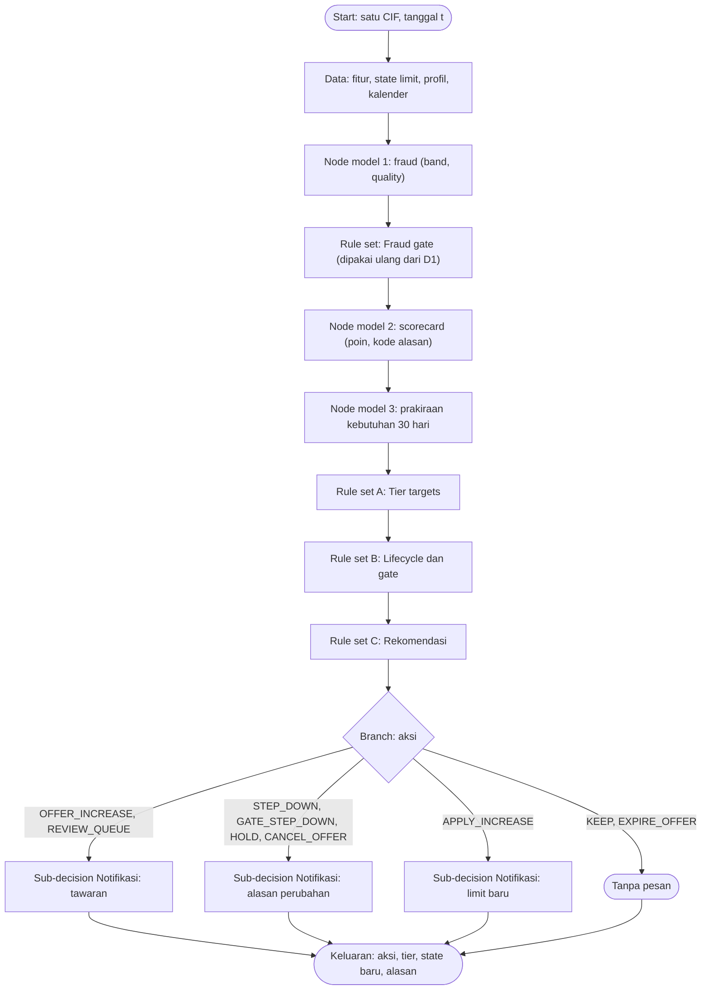
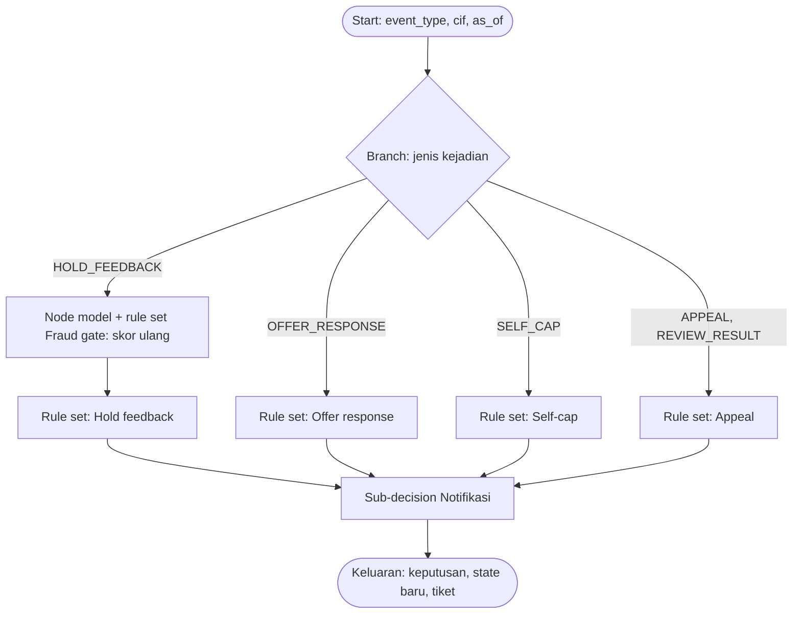

# Decision flow di SAS Intelligent Decisioning: D1, D2, D3

Disusun 27 Oktober 2026. Rincian isi tiap decision, node, dan **rule set** yang harus dibangun di Intelligent Decisioning, dengan pemanggilan model yang sudah kita punya. Konteks: [STORYBOARD.md](STORYBOARD.md) (frame 2.6 dan 3.5–3.9), [DIAGRAMS.md](DIAGRAMS.md), [INTELLIGENT_DECISIONING_BLUEPRINT.md](INTELLIGENT_DECISIONING_BLUEPRINT.md) (rincian D1 dan berkas uji).

**Status:** logika ditranskripsi dari kode Python yang sudah teruji (`serving/gate.py`, `limit/policy.py`, `serving/limit_service.py`, `serving/app.py`) dan contoh hitungan diverifikasi dengan `limit/policy.py`. **Belum dibangun di Viya** kecuali D1 (dilaporkan sudah dibangun, belum diverifikasi). Hal yang bergantung pada versi Viya ditandai **[cek lab]**; asumsi yang belum disetujui tim ditandai **[asumsi]**.

## 1. Ringkasan: tiga decision dan komponen yang dipakai ulang
| Decision | Pemicu | Dipanggil oleh | Model | Keluaran utama |
|---|---|---|---|---|
| **D1 Fraud verdict** | per transaksi (real-time) | middleware, lewat endpoint gateway | fraud | ALLOW / STEP_UP_AUTH / HOLD |
| **D2 Evaluasi limit** | tiap malam 02.00 (atau per nasabah sesuai permintaan) | job terjadwal Viya | fraud, scorecard, prakiraan kebutuhan | aksi limit, tier baru, state baru, alasan |
| **D3 Respons nasabah** | umpan balik dari channel | middleware | fraud (skor ulang) | lepas / blokir / tawaran diterima / self-cap / tiket banding |

Dipisah karena pemicu, kecepatan, dan pemanggilnya berbeda: D1 harus < 150 ms, D2 adalah batch, D3 digerakkan kejadian. D1 dan D3 diekspos ke middleware; D2 hanya dipanggil dari dalam Viya.

**Padanan dengan penamaan lama (F1–F8):** F1 = D1; F2 = D2; F3, F4, F5 = D3; F6 = sub-decision Notifikasi; F7 = job pemantauan dan retrain (bukan decision); F8 (evaluasi ulang karena sinyal, opsional) = D1 dipanggil ulang saat ada sinyal.

**Objek yang dipakai ulang** (dibuat sekali, dipakai di beberapa decision):
| Objek | Jenis | Dipakai di |
|---|---|---|
| `fraudXgbMaskV11` | node model | D1, D2, D3 |
| `limitScorecard` | node model (**belum dibuat**) | D2 |
| `demandForecastQ95` | node model (**belum dibuat**) | D2 |
| **Fraud gate** | rule set | D1, D2, D3 |
| **Verdict** | rule set | D1, D3 |
| **Tier targets** | rule set | D2 |
| **Lifecycle dan gate**, **Rekomendasi** | rule set | D2 |
| **Notifikasi** | sub-decision | D1, D2, D3 |

## 2. Cara memanggil model di decision
1. **Pastikan model ada di Model Manager dan ter-publish.** `fraudXgbMaskV11`: sudah (proyek `sashckton-gearup`, modul MAS `fraudxgbmaskv11`). Scorecard dan prakiraan kebutuhan: belum.
2. Di decision, tambah **node Model**, pilih model (nama dan versi, atau champion).
3. **Petakan masukan.** Nama variabel kita sama dengan nama fitur model, sehingga pemetaan umumnya otomatis. Variabel yang tidak ada di decision harus dibuat dulu.
4. **Keluaran model menjadi variabel decision** yang bisa dibaca node dan rule set berikutnya.
5. **Uji di tab Scoring** dengan tabel uji (lihat bagian 8).
6. Bila versi Viya tidak mengizinkan model Python sebagai node model **[cek lab]**: gunakan code file yang memanggil modul MAS (REST), atau publish modelnya sebagai modul dan panggil dari decision.

| Model | Masukan | Keluaran |
|---|---|---|
| **fraudXgbMaskV11** | 63 fitur (daftar di `sas_export/decisioning/variables.csv` dan [FEATURES_AND_EXPLAINABILITY.md](FEATURES_AND_EXPLAINABILITY.md)) | `EM_EVENTPROBABILITY`, `EM_CLASSIFICATION`, `band`, `quality` |
| **limitScorecard** | 5 fitur: `payee_concentration_90`, `inflow_cv_90`, `passthrough_7`, `declared_income`, `distinct_per_tx_30` (semuanya sudah di antara 63 fitur) | `score_points` dan tiga `reason_code` |
| **demandForecastQ95** | 18 fitur: `out_30`, `out_7`, `avg_out_90`, `p95_out_30`, `p95_out_90`, `out_trend_30`, `out_to_income_30`, `max_out_7_to_income`, `spike_ratio_7_vs_90`, `near_limit_days_90`, `declined_cnt_90`, `n_out_7`, `inflow_30`, `declared_income`, `balance`, `tenure_months` (umur rekening sebenarnya), `ramadan_overlap`, `school_overlap` | `forecast_peak_need` (Rp, kuantil 0,95 kebutuhan puncak 30 hari) |

**Perhatian untuk scorecard dan prakiraan:** DATA step (`sas_export/scorecard/scorecard_score.sas`) cocok untuk SAS Compute atau job batch, tetapi **tidak bisa dijalankan di MAS**, yang hanya mengeksekusi DS2 atau Python. Karena spesifikasi scorecard kita sudah berupa JSON (`limit/artifacts/scorecard.json`) dan prakiraan berupa model XGBoost, jalur termudah adalah membungkus keduanya sebagai model Python (paket `pzmm`, seperti model fraud). Lima variabel tambahan untuk prakiraan (`near_limit_days_90`, `declined_cnt_90`, `tenure_months` sebenarnya, `ramadan_overlap`, `school_overlap`) tidak ada di 63 fitur dan harus disuplai: dua dari riwayat transaksi, satu dari tanggal buka rekening, dua dari kalender.

## 3. D1: Fraud verdict (real-time)

**Masukan dari middleware:** `cif`, nominal, waktu, id payee, kategori, penanda lokasi tidak cocok. Fitur, profil, dan batas harian dibaca dari Postgres **[cek lab: node query atau lookup]**. **Keluaran:** `verdict`, `block_increase`, `band`, `quality`, tujuh flag `hit_*`, `gate_codes`.

**Code file "gabungkan transaksi":** menghitung ulang fitur hari berjalan (`out_1`, `n_out_1`, `new_payee_1`, `distinct_payee_1`, `top_payee_share_1`, `night_share_1`, `out_to_balance_1`, `out_1_vs_avg30`, `mix_*_1`, `ftp_large_1`, `geo_mismatch_share_1`, serta agregat 7 dan 30 hari yang memuat hari ini) dengan menambahkan transaksi yang sedang diputuskan. Logikanya adalah `serving/store.py::ingest` dan `serving/rolling.py`; **uji paritas terhadap oracle Python wajib**.

### Rule set 1: Fraud gate (evaluasi semua aturan)
Variabel konteks tambahan (dibaca dari Postgres): `daily_cap`, `ftp_large_today`, `night_outflow_today`, `outflow_today`, `alerts_30`, `disputes_30`.
| Aturan | Kode | Kondisi | `gate_hold` | `gate_step_up` | `gate_block` |
|---|---|---|---|---|---|
| G1 | FRAUD_SCORE_H | `band = "high_risk"` | 1 | 0 | 1 |
| G2 | NEW_DEVICE | `new_device_7 > 0` | 0 | 0 | 1 |
| G3 | CREDENTIAL_CHANGE | `cred_change_3 > 0` | 0 | 0 | 1 |
| G4 | FIRST_PAYEE_LARGE | `ftp_large_today > 0` | 0 | 1 | 1 |
| G5 | NIGHT_VELOCITY | `night_outflow_today > 0.3 * daily_cap` | 0 | 1 | 1 |
| G6 | OUTFLOW_BALANCE | `(balance + outflow_today) > 50000000 AND outflow_today > 0.5 * (balance + outflow_today)` | 0 | 1 | 1 |
| G7 | OPEN_ALERT_OR_DISPUTE | `alerts_30 > 0 OR disputes_30 > 0` | 0 | 0 | 1 |
Setiap aturan yang cocok mengisi `hit_<kode> = 1`. Nilai kosong membuat perbandingan bernilai salah (aturan tidak memicu) **[cek lab]**.

### Rule set 2: Verdict (berurutan, yang pertama cocok menang)
| Urut | Kondisi | `verdict` |
|---|---|---|
| V1 | `gate_hold = 1 OR band = "high_risk"` | HOLD |
| V2 | `gate_step_up = 1 OR band = "suspicious"` | STEP_UP_AUTH |
| V3 | selain itu | ALLOW |
Keluaran tambahan: `block_increase = 1` bila `gate_block = 1` atau `band <> "genuine"`.
**Aturan opsional V0 [asumsi]:** `quality = "low" AND verdict = "ALLOW"` → `STEP_UP_AUTH` (saat ini data kosong banyak menghasilkan ALLOW). Belum diputuskan tim; tidak ada di backend Python.

**Bukti:** tabel di atas setara dengan `serving/gate.py` pada 3.000 baris acak; 43 kasus uji tersedia di `sas_export/decisioning/`.

## 4. D2: Evaluasi limit (tiap malam)

Job terjadwal memilih nasabah layak, memanggil D2 per CIF, lalu menulis keluaran (state baru, tabel limit, log) ke Postgres. **Gate dievaluasi dengan data sampai kemarin** (konteks `*_today` berisi catatan hari kemarin).

### 4.1 Masukan
| Kelompok | Variabel |
|---|---|
| Kunci | `cif`, `as_of_date` |
| 63 fitur model | dari tabel `features` (fitur sampai kemarin) |
| Konteks gate | `daily_cap` (cap tier saat ini), `ftp_large_today`, `night_outflow_today`, `outflow_today`, `alerts_30`, `disputes_30` (semua untuk hari kemarin) |
| Tambahan scorecard dan prakiraan | `near_limit_days_90`, `declined_cnt_90`, `tenure_months_true` (bulan sejak tanggal buka rekening), `ramadan_overlap`, `school_overlap` |
| Kelayakan | `hist_days`, `disputes_90` (jumlah sengketa 90 hari), `kyc_age_months`, `regular_inflow_windows_90`, `n_out_7`, `out_30` |
| State limit (`limit_state`) | `baseline_tier`, `tier`, `tier_since_date`, `last_change_date`, `consec_lower`, `offer_to`, `offer_date`, `accepted_date`, `dismissed_until_date`, `self_cap`, `pinned_until_date` |
Di prototipe, tanggal disimpan sebagai nomor hari sejak 1 Juli 2025; di Viya pakai tanggal dan hitung selisihnya.

### 4.2 Rule set "Derived" (penetapan variabel turunan, sebelum Rule set A)
| Variabel | Rumus |
|---|---|
| `gate_block` | `gate_block_flag = 1 OR band <> "genuine"` |
| `gate_hold` | `gate_hold_flag = 1 OR band = "high_risk"` |
| `days_since_change` | `as_of_date - last_change_date` |
| `months_at_tier` | `(as_of_date - tier_since_date) / 30.4` |
| `offer_age_days` | `as_of_date - offer_date` |
| `offer_due` | `offer_to > 0 AND accepted_date tidak kosong AND as_of_date >= accepted_date + 1` |
| `eligible` | `tenure_months_true >= 12 AND hist_days >= 30 AND (pinned_until_date kosong OR as_of_date >= pinned_until_date) AND gate_block = 0` |
| `active_recent` | `n_out_7 > 0 OR out_30 > 0` |

### 4.3 Rule set A: Tier targets (yang pertama cocok menang)
Batas poin berasal dari `limit/artifacts/tier_cuts.json` (dikalibrasi ke persentil populasi latih; **perlu dikalibrasi ulang dengan data bank**).
**`ceiling_tier`** (dari `score_points` dan syarat nasabah). Definisi: `ok2 = regular_inflow_windows_90 >= 3 AND disputes_90 <= 0 AND score_points >= 611.8`; `ok3 = ok2 AND score_points >= 629.5`; `ok4 = ok3 AND score_points >= 648.0 AND kyc_age_months <= 24`; `ok5 = ok4 AND score_points >= 664.8 AND kyc_age_months <= 12`.
| Urut | Kondisi | `ceiling_tier` |
|---|---|---|
| A1 | `ok5` | 5 |
| A2 | `ok4` | 4 |
| A3 | `ok3` | 3 |
| A4 | `ok2` | 2 |
| A5 | selain itu | 1 |
**`demand_tier`** (dari `forecast_peak_need`; ambang = 60% dari batas tier di bawahnya):
| Urut | Kondisi | `demand_tier` |
|---|---|---|
| A6 | `forecast_peak_need > 60000000` | 5 |
| A7 | `> 30000000` | 4 |
| A8 | `> 15000000` | 3 |
| A9 | `> 6000000` | 2 |
| A10 | selain itu | 1 |

### 4.4 Rule set B: Lifecycle dan gate (semua aturan, berurutan; penetapan terlihat oleh aturan berikutnya **[cek lab]**)
Bila penetapan variabel tidak terlihat oleh aturan berikutnya dalam satu rule set, pecah B1–B7 menjadi beberapa rule set berurutan. `action` awalnya kosong.
| # | Kondisi | Penetapan |
|---|---|---|
| B1 | `self_cap > 0 AND tier > self_cap` | `tier = self_cap`; `last_change_date = tier_since_date = as_of_date` |
| B2 | `offer_due AND gate_block = 1` | `action = "CANCEL_OFFER"`; `dismissed_until_date = as_of_date + 30`; hapus tawaran (`offer_to = 0`, `offer_date`, `accepted_date` kosong) |
| B3 | `offer_due AND gate_block = 0 AND (self_cap = 0 OR offer_to <= self_cap)` | `action = "APPLY_INCREASE"`; `tier = offer_to`; `tier_since_date = last_change_date = as_of_date`; hapus tawaran |
| B4 | `offer_to > 0 AND accepted_date kosong AND offer_age_days > 14` | `action = "EXPIRE_OFFER"`; `dismissed_until_date = as_of_date + 30`; hapus tawaran |
| B5 | `gate_hold = 1 AND tier > baseline_tier` | `action = "GATE_STEP_DOWN"`; `tier = MAX(tier - 1, baseline_tier)`; `last_change_date = tier_since_date = as_of_date`; hapus tawaran |
| B6 | `gate_hold = 1 AND action kosong` | `action = "HOLD"` |

### 4.5 Rule set C: Rekomendasi
Variabel (dihitung dengan `tier` setelah Rule set B):
`rec_raw = MIN(ceiling_tier, demand_tier, tier + 1)`; bila `self_cap > 0` maka `rec = MIN(rec_raw, self_cap)`; bila `rec >= 3 AND rec > tier AND months_at_tier < 6` maka `rec = tier`. `cool = days_since_change >= 7`. `can_offer = eligible AND rec > tier AND cool AND offer_to = 0 AND (dismissed_until_date kosong OR as_of_date >= dismissed_until_date) AND action kosong`. `lower_flag = eligible AND MAX(rec, baseline_tier) < tier AND active_recent`.
| # | Kondisi | Penetapan |
|---|---|---|
| C1 | `can_offer AND rec = 5` | `action = "REVIEW_QUEUE"` (tier 5 butuh tinjauan manual) |
| C2 | `can_offer AND rec < 5` | `action = "OFFER_INCREASE"`; `offer_to = rec`; `offer_date = as_of_date` |
| C3 | selalu | `consec_lower = IF lower_flag THEN consec_lower + 1 ELSE 0` |
| C4 | `lower_flag AND consec_lower >= 14 AND cool AND action kosong` | `action = "STEP_DOWN"`; `tier = MAX(rec, baseline_tier)`; `last_change_date = tier_since_date = as_of_date`; `consec_lower = 0`; hapus tawaran |
| C5 | `action kosong` | `action = "KEEP"` |
Catatan: tidak layak (`eligible = 0`) berarti tidak ada tawaran dan tidak ada penurunan; nasabah tetap di tier saat ini (tier dasar bila belum pernah berubah). **Lantai yang tidak boleh ditawar:** tier tidak pernah turun di bawah `baseline_tier` kecuali nasabah sendiri menurunkannya (B1) atau petugas mengunci tier (D3). `lower_needed = 14` adalah penyimpangan sadar dari proposal (3).

### 4.6 Keluaran D2
`action`, `tier_after`, `offer_to_after`, seluruh state baru (`tier_since_date`, `last_change_date`, `consec_lower`, `offer_date`, `accepted_date`, `dismissed_until_date`), `score_points` dan tiga `reason_code`, `forecast_peak_need`, `ceiling_tier`, `demand_tier`, `band`, flag gate, dan `message_code` untuk sub-decision Notifikasi.

### 4.7 Contoh hitungan (diverifikasi dengan `limit/policy.py`)
| Kasus | Masukan ringkas | Hasil |
|---|---|---|
| Tawaran naik | tier dasar 2, tier 2, masa kerja 20 bulan, di tier 8 bulan, perubahan terakhir 30 hari lalu, poin 640, inflow teratur 3, tanpa sengketa, KYC 10 bulan, prakiraan Rp40 juta | `ceiling_tier = 3`, `demand_tier = 4`, `rec = MIN(3, 4, 3) = 3` → **OFFER_INCREASE** ke tier 3 |
| Gate menyala | tier dasar 2, tier 3, band high_risk | **GATE_STEP_DOWN** ke tier 2 (dan HOLD pada transaksi) |
| Nasabah baru | masa kerja 8 bulan | tidak layak → **KEEP** |
| Tawaran jatuh tempo | tawaran tier 3, diterima kemarin, tanpa gate | **APPLY_INCREASE** ke tier 3 |
| Tier 5 | tier 4, poin 670, KYC 8 bulan, prakiraan Rp150 juta | `rec = 5` → **REVIEW_QUEUE** |
| Di tier < 6 bulan | tier 2 sejak 100 hari, rec akan 3 | `rec` ditahan di tier 2 → **KEEP** |
| Turun | tier 4, tier dasar 2, poin 600, prakiraan Rp2 juta, sudah 13 evaluasi lebih rendah | evaluasi ke-14 → **STEP_DOWN** ke tier 2 (tidak di bawah tier dasar) |

**Penyederhanaan penting:** pada kode kita, **evaluasi malam sendiri yang menerapkan tawaran yang jatuh tempo** (≥ 1 hari setelah diterima, aturan B3). Jadi untuk tier tidak perlu job timer terpisah; timer hanya dibutuhkan untuk batas waktu hold 24 jam di D3. Diagram 5 dan 8 di [DIAGRAMS.md](DIAGRAMS.md) sudah mengikuti penyederhanaan ini.

## 5. D3: Respons nasabah

**Masukan:** `event_type`, `cif`, `as_of` ditambah data kejadian (hasil verifikasi, `requested_tier`, jenis tawaran, hasil tinjauan) dan state limit.

### Rule set "Hold feedback" (berurutan)
Skor ulang memakai fitur terbaru; `band_after` dan `gate_hold_after` adalah hasil skor ulang. `hold_age_hours` = jam sejak transaksi ditahan.
| # | Kondisi | `decision` | Efek |
|---|---|---|---|
| H1 | `feedback = "CONFIRM" AND hold_age_hours <= 24 AND band_after <> "high_risk" AND gate_hold_after = 0` | RELEASE | lepaskan transaksi, catat hasil |
| H2 | `feedback = "CONFIRM" AND (band_after = "high_risk" OR gate_hold_after = 1)` | KEEP_HOLD_REVIEW | tetap tahan, kirim ke tim fraud **[asumsi]** (korban scam bisa dikoordinasi penipu untuk menjawab "ini saya") |
| H3 | `feedback = "AUTH_OK" AND gate_hold_after = 0` | RELEASE | lolos step-up |
| H4 | `feedback = "AUTH_FAIL"` | BLOCK_TXN | batalkan transaksi |
| H5 | `feedback = "DENY"` | BLOCK | blokir, buat kasus fraud di Workflow Manager, `label_awal = 1` |
| H6 | `feedback kosong AND hold_age_hours > 24` | EXPIRE | batalkan transaksi **[asumsi: 24 jam mengikuti aturan hold proposal]** |
Batas waktu 24 jam diperiksa job terjadwal yang memanggil D3 dengan `feedback` kosong untuk hold yang masih terbuka.

### Rule set "Offer response"
| # | Kondisi | Penetapan |
|---|---|---|
| O1 | `event = "ACCEPT_OFFER" AND offer_to > 0 AND accepted_date kosong AND gate_block = 0` | `accepted_date = as_of`; status "berlaku pada evaluasi malam berikutnya (≥ 24 jam)" |
| O2 | `event = "ACCEPT_OFFER" AND offer_to > 0 AND gate_block = 1` | `action = "CANCEL_OFFER"`; `dismissed_until_date = as_of + 30`; hapus tawaran |
| O3 | `event = "DECLINE_OFFER"` | hapus tawaran; `dismissed_until_date = as_of + 30` |
| O4 | `event = "ACCEPT_OFFER" AND (offer_to = 0 OR accepted_date tidak kosong)` | status "tidak ada tawaran aktif" |

### Rule set "Self-cap"
| # | Kondisi | Penetapan |
|---|---|---|
| S1 | `requested_tier >= 1 AND requested_tier <= tier` | `self_cap = requested_tier`; `tier = requested_tier`; `last_change_date = tier_since_date = as_of`; hapus tawaran bila `offer_to > requested_tier` (berlaku seketika) |
| S2 | `requested_tier > tier` | `self_cap = requested_tier` (hanya menaikkan batas atas); `tier` tetap; kenaikan tier **hanya lewat tawaran** |
| S3 | `requested_tier < 1` | tolak |

### Rule set "Appeal"
| # | Kondisi | Penetapan |
|---|---|---|
| A1 | `event = "APPEAL"` | buat tiket di Workflow Manager: `cif`, `last_action`, `sla = 2 hari kerja`; `priority = "HIGH"` bila `last_action` termasuk HOLD atau GATE_STEP_DOWN, selain itu "NORMAL" **[asumsi]** |
| A2 | `event = "REVIEW_RESULT" AND outcome = "PIN"` | `tier = pinned_tier`; `pinned_until_date = as_of + 182` (6 bulan); `last_change_date = tier_since_date = as_of`; hapus tawaran |
| A3 | `event = "REVIEW_RESULT" AND outcome = "REJECT"` | tidak ada perubahan; kirim pemberitahuan hasil |

## 6. Sub-decision Notifikasi (F6)
Masukan: `action` atau `verdict`, `cap` (dalam juta rupiah), alasan. Aturan memilih templat, kanal, dan waktu kirim.
| Aksi atau verdict | Templat (padanan di `serving/limit_service.py` dan `serving/app.py`, diterjemahkan) | Waktu |
|---|---|---|
| OFFER_INCREASE | "Limit transfer harian Anda bisa naik ke Rp{cap} juta karena pendapatan stabil, tanpa sengketa, dan kebutuhan transfer yang bertumbuh. Terima? Berlaku 24 jam setelah Anda menerima." | setelah 07.00 |
| APPLY_INCREASE | "Limit transfer harian Anda sekarang Rp{cap} juta." | setelah 07.00 |
| STEP_DOWN | "Limit Anda menjadi Rp{cap} juta karena aktivitas menurun beberapa minggu terakhir. Anda dapat meminta tinjauan, dibalas dalam 2 hari kerja." | setelah 07.00 |
| GATE_STEP_DOWN | "Demi keamanan, limit Anda diturunkan ke Rp{cap} juta setelah ada aktivitas tidak biasa. Anda dapat meminta tinjauan, dibalas dalam 2 hari kerja." | segera |
| HOLD (limit) | "Sebuah transfer ditahan demi keamanan Anda. Konfirmasi di aplikasi setelah autentikasi tambahan atau hubungi kami." | segera |
| CANCEL_OFFER | "Kenaikan limit yang tertunda dibatalkan karena alasan keamanan. Anda dapat meminta tinjauan." | segera |
| EXPIRE_OFFER | "Tawaran limit Anda berakhir. Anda akan menerima tawaran baru setelah 30 hari bila masih memenuhi syarat." | setelah 07.00 |
| REVIEW_QUEUE | "Permintaan Anda untuk tier tertinggi menunggu tinjauan manual." | setelah 07.00 |
| verdict HOLD | "Transfer ditahan demi keamanan ({alasan}). Konfirmasi di aplikasi setelah autentikasi tambahan atau hubungi kami." | segera |
| verdict STEP_UP_AUTH | "Mohon konfirmasi transfer ini dengan autentikasi tambahan ({alasan})." | segera |
| KEEP, ALLOW | tidak ada pesan | |
`{alasan}` berisi dua kode aturan gate pertama dalam bahasa awam (misalnya "perangkat baru", "aktivitas malam"). Alasan SHAP model **tidak** tersedia dari modul MAS (hanya `band` dan kode aturan). Kanal: push dan kotak masuk aplikasi; SMS sebagai cadangan untuk hold **[asumsi]**. Batas frekuensi: satu pesan limit per hari per nasabah **[asumsi]**. Pesan dikirim sebagai aksi ke Kafka (atau ke channel langsung), bukan dari dalam decision.

## 7. Data yang dibaca dan ditulis tiap decision
| Decision | Membaca (Postgres) | Menulis |
|---|---|---|
| D1 | `features`, agregat hari ini (`daily`), `customer`, `limit_state` (tier, cap) | log keputusan (lewat Kafka atau job); `hold` terbuka |
| D2 | `features`, `customer`, `limit_state`, riwayat transaksi untuk `near_limit_days_90` dan `declined_cnt_90`, `events` untuk `disputes_90` | `limit_state`, tabel limit (dibaca core banking), log, antrean notifikasi |
| D3 | `limit_state`, hold terbuka, tiket | `limit_state`, status hold, tiket, label awal fraud |
Penulisan dilakukan oleh **pemanggil** (job atau layanan di sekitar decision), bukan di tengah decision, supaya decision tetap tanpa state **[cek lab: apakah decision boleh menulis langsung]**.

## 8. Rencana uji
| Decision | Alat uji | Status |
|---|---|---|
| D1 | `sas_export/decisioning/id_test_input.csv` dan `id_test_expected.csv` (43 kasus); `decision_flow_ref.py --check-backend 3000` | **ada** |
| D2 | `limit/policy.py` dan `serving/limit_service.py` sebagai oracle; tabel uji dengan state dan masukan lengkap, hasil yang diharapkan dari oracle (kasus di 4.7 sebagai awal) | **belum dibuat** |
| D3 | `serving/limit_service.py` (`accept`, `set_self_cap`, `appeal`, `review`) sebagai oracle; kasus uji per jenis kejadian | **belum dibuat** |
| Model scorecard dan prakiraan | pembungkus `pzmm`, uji paritas terhadap `limit/scorecard.py` dan `limit/forecast.py` | **belum dibuat** |

Urutan membangun yang disarankan: (1) verifikasi D1 dengan berkas uji, (2) bungkus scorecard dan prakiraan sebagai model MAS, (3) bangun D2 (rule set A, B, C) dan uji dengan oracle, (4) D3, (5) sub-decision Notifikasi, (6) sambungkan job terjadwal dan Postgres.

## 9. Asumsi dan pertanyaan terbuka
* **Node data ke Postgres di dalam decision [cek lab]:** bila tidak ada, data dilampirkan oleh pemanggil (job atau middleware) sebagai masukan decision.
* **Penetapan variabel yang terlihat antar aturan [cek lab].**
* **Aturan V0** untuk `quality = low` belum diputuskan.
* **Aturan H2** (konfirmasi pada transaksi yang tetap high_risk tidak dilepas) dan batas 24 jam adalah asumsi yang harus disetujui tim fraud.
* **Batas poin tier** dari data sintetis; kalibrasi ulang dengan data bank.
* **Tier 5 selalu lewat tinjauan manual** (proposal §4.2).
* **Kasus tepi yang diketahui:** tawaran yang diterima lalu `self_cap` diturunkan di bawah tawaran dibersihkan oleh Rule set "Self-cap" (S1); di luar itu, tawaran yang melebihi `self_cap` tidak dapat muncul karena `rec` dibatasi `self_cap`.
