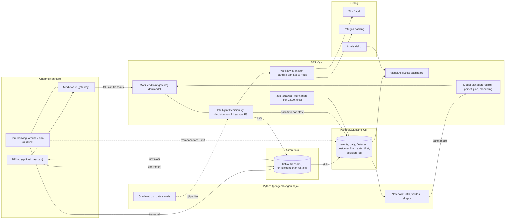
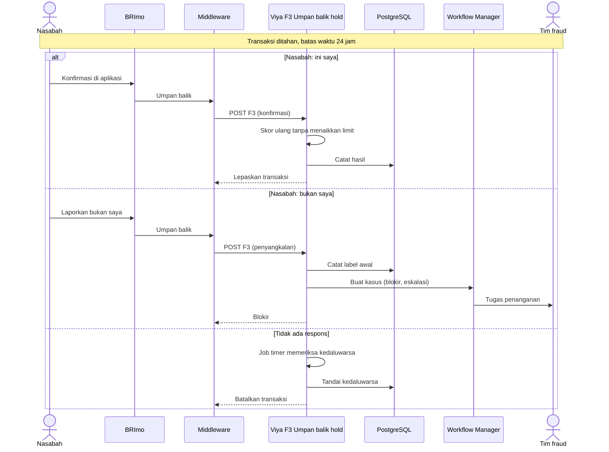
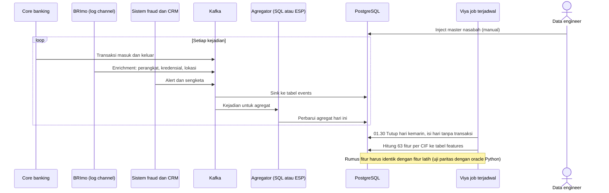
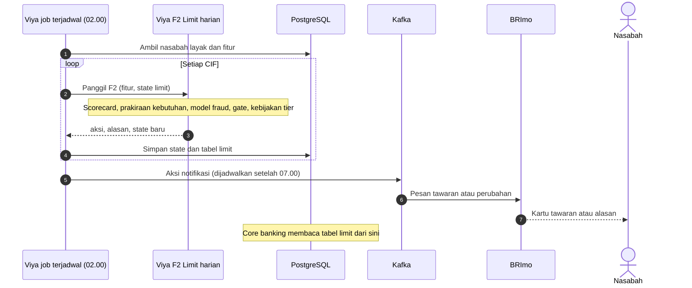
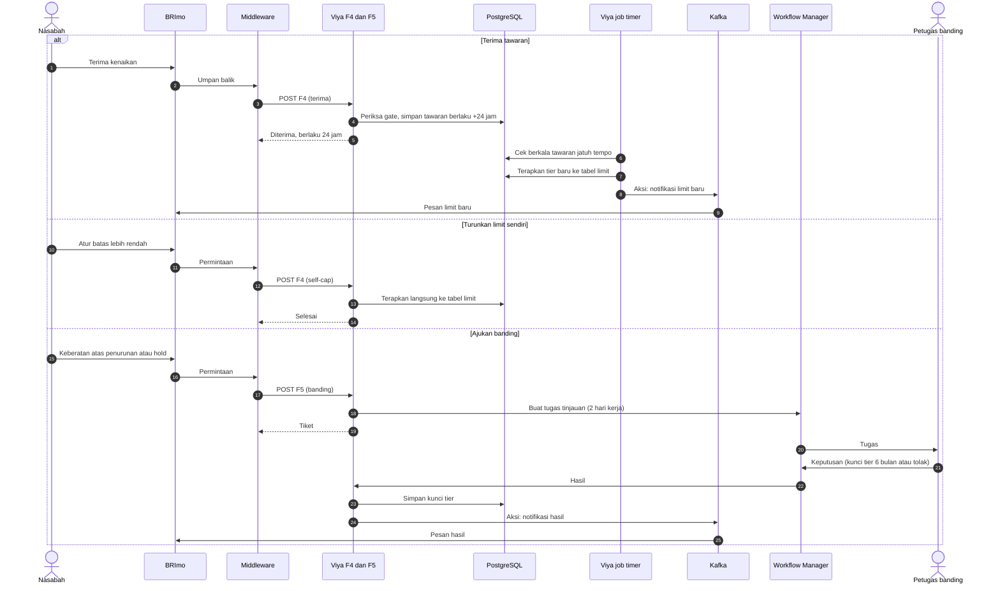
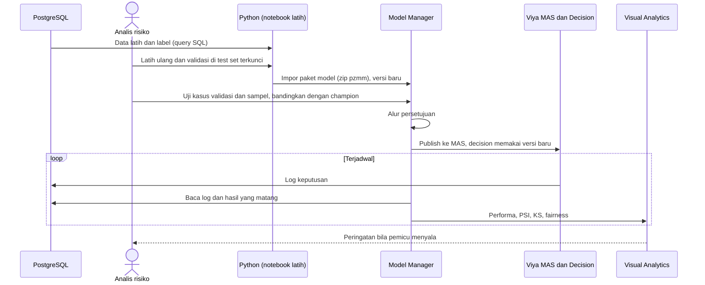
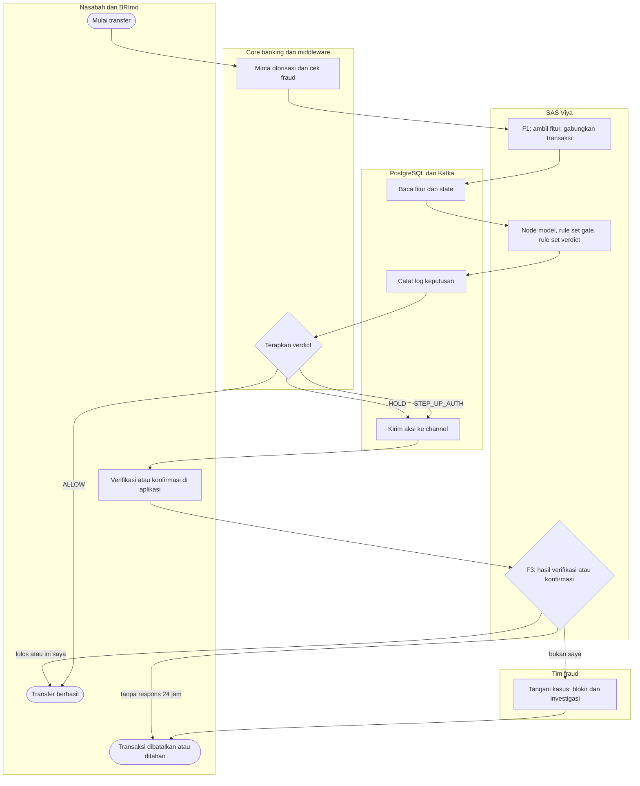
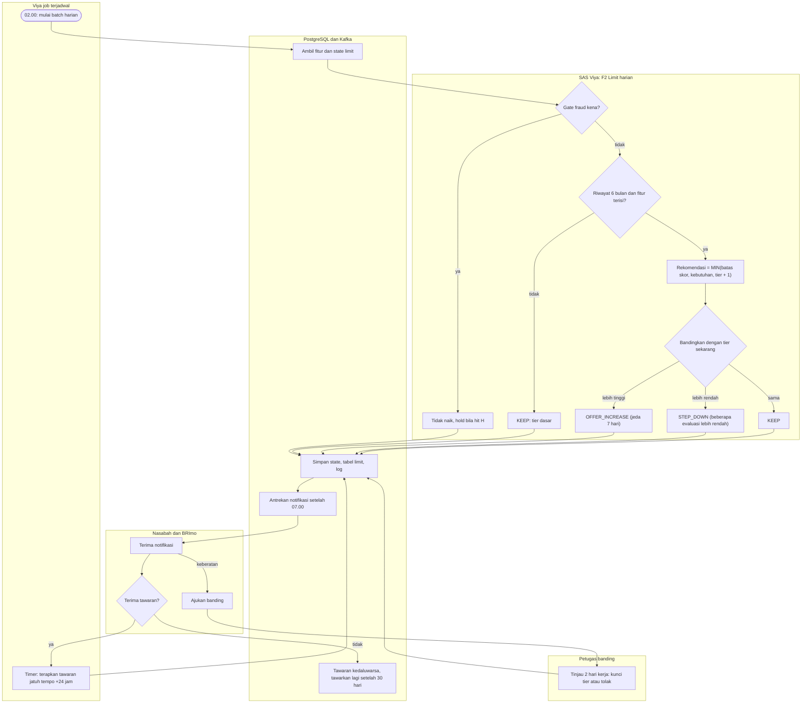

# Diagram proses end-to-end, versi 2 (Viya sebagai pusat keputusan)

Diperbarui 27 Oktober 2026. Menggantikan versi 1 (yang memakai backend Python di runtime). Dasar keputusan:
- **PostgreSQL** (kunci CIF) menyimpan semua data dan dapat diakses dari Viya dan Python. Transaksi masuk dan keluar lengkap; enrichment channel (perangkat, kredensial, lokasi) masuk lewat **Kafka**.
- **SAS Viya** adalah satu-satunya yang diketahui middleware (endpoint gateway). Model ada di Viya dan dipanggil dari **Intelligent Decisioning** (banyak decision flow). Viya mengirim aksi ke channel dan menerima umpan balik nasabah.
- **Python hanya untuk pengembangan model** (latih ulang, ekspor ke Viya) serta sebagai oracle uji dan data sintetis.
- Asumsi default nomor 1–12 diberlakukan (lihat [STORYBOARD.md](STORYBOARD.md) frame 3.12). Hal yang bergantung pada versi Viya ditandai **[cek lab]**.

Singkatan decision flow: F1 fraud verdict, F2 limit harian, F3 umpan balik step-up dan hold, F4 tawaran dan self-cap, F5 banding, F6 notifikasi, F7 pemantauan dan retrain, F8 (opsional) evaluasi ulang karena sinyal.

## 0. Arsitektur komponen

## 1. Sequence: keputusan transaksi real-time (F1) dengan step-up dan hold

## 2. Sequence: hold dan umpan balik nasabah (F3)

## 3. Sequence: data masuk dan fitur harian

## 4. Sequence: evaluasi limit harian 02.00 (F2)

## 5. Sequence: tawaran, self-cap, banding (F4, F5)

## 6. Sequence: siklus hidup model dan pemantauan (F7)

## 7. Activity: transaksi real-time dengan siklus hold

## 8. Activity: limit harian dan siklus tawaran

## Status per diagram
| Diagram | Sudah ada | Masih rencana |
|---|---|---|
| 0. Arsitektur | model di Model Manager dan MAS; laporan Visual Analytics; Python (latih, oracle) | Postgres, Kafka, job terjadwal, Workflow Manager, caslib ke Postgres |
| 1. F1 | cetak biru F1 ([INTELLIGENT_DECISIONING_BLUEPRINT.md](INTELLIGENT_DECISIONING_BLUEPRINT.md)); F1 dilaporkan sudah dibangun di lab, belum diuji dengan berkas uji kita | membaca fitur dari Postgres di dalam decision **[cek lab]**, menggabungkan transaksi yang diputuskan, panggilan aksi ke Kafka |
| 2. F3 | logika gate dan verdict | seluruh siklus hold dan kasus fraud |
| 3. Data dan fitur | rumus fitur dan oracle paritas di Python | sink Kafka, agregator, job fitur di Viya |
| 4. F2 | logika kebijakan, scorecard (DATA step), prakiraan (model Python) di Python | decision F2 di Viya, model prakiraan di MAS |
| 5. F4 dan F5 | logika di Python | semua di Viya, timer, Workflow Manager |
| 6. Model | impor, uji 25 kasus, publish MAS | persetujuan, monitoring Model Manager, pemicu |
| 7 dan 8. Activity | menggambarkan target | idem |
