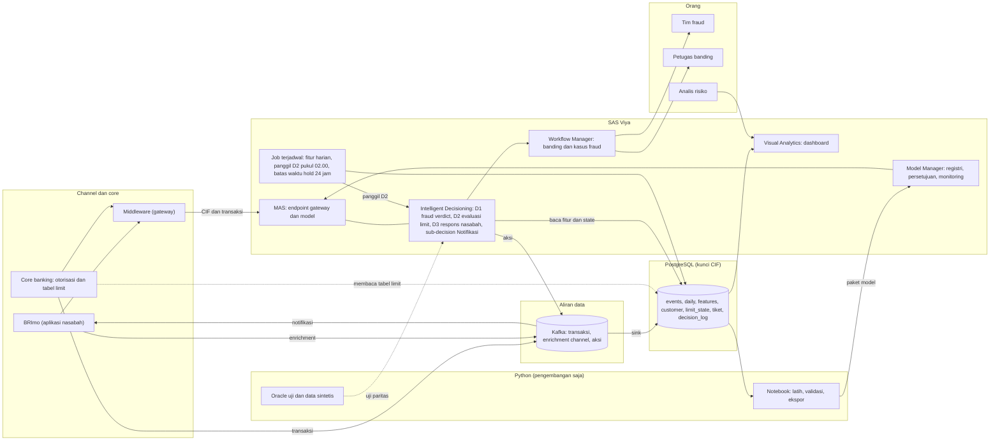
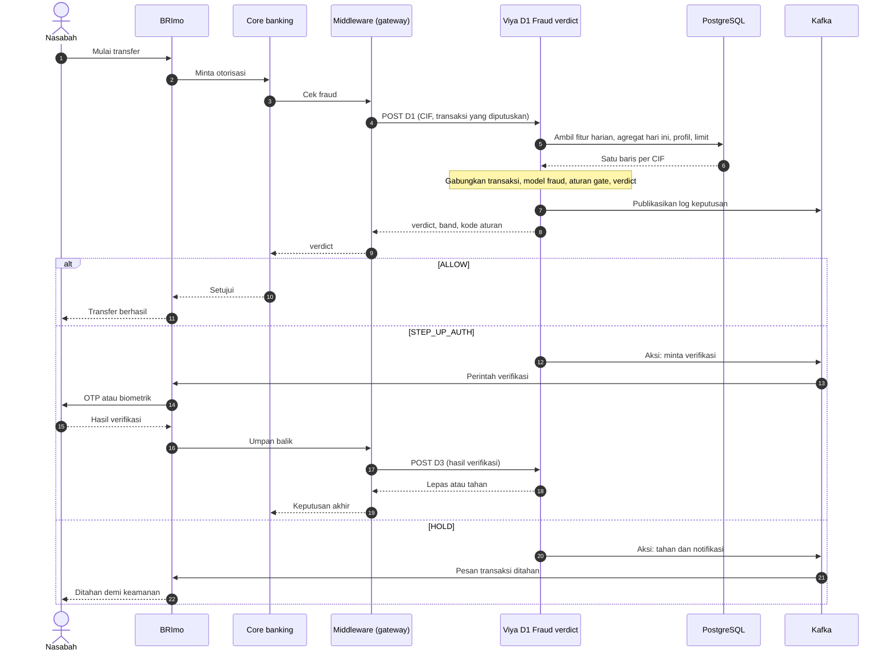
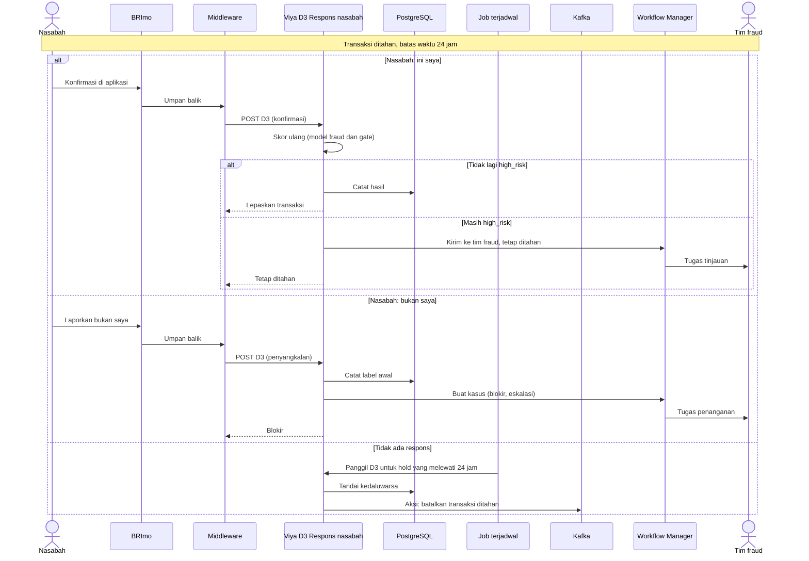
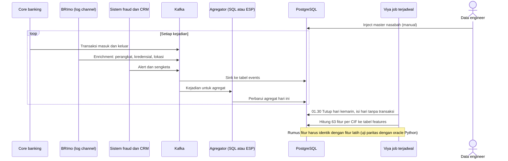
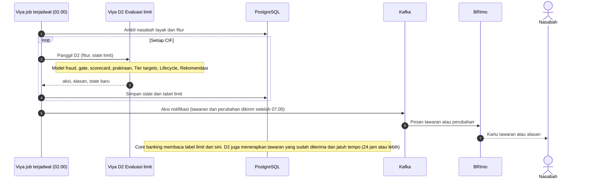
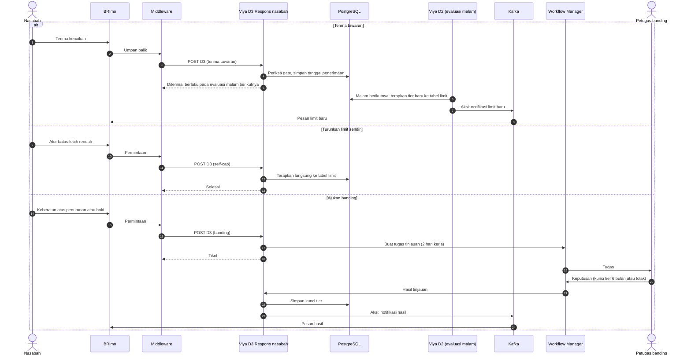
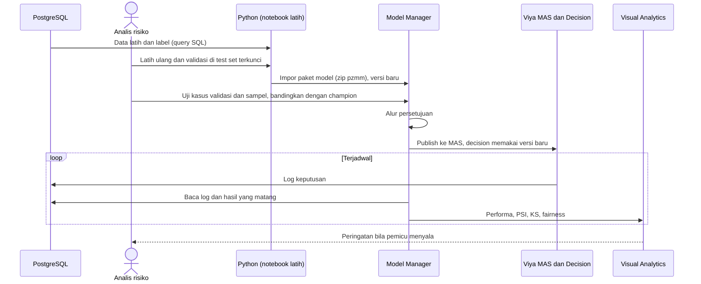
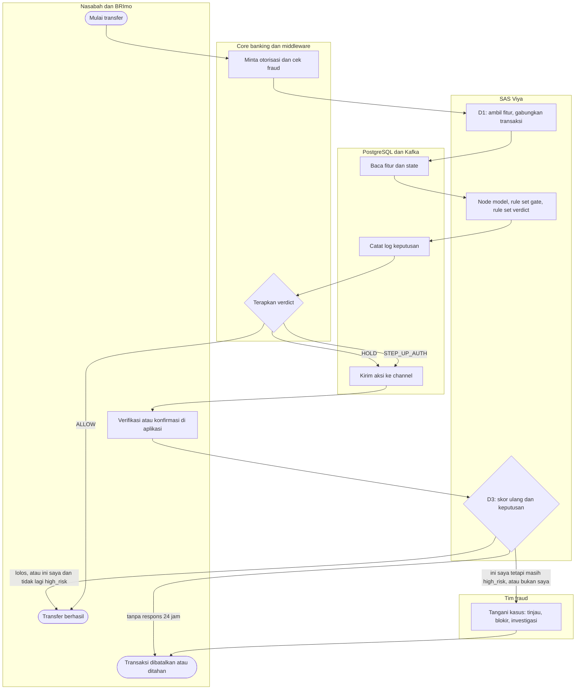
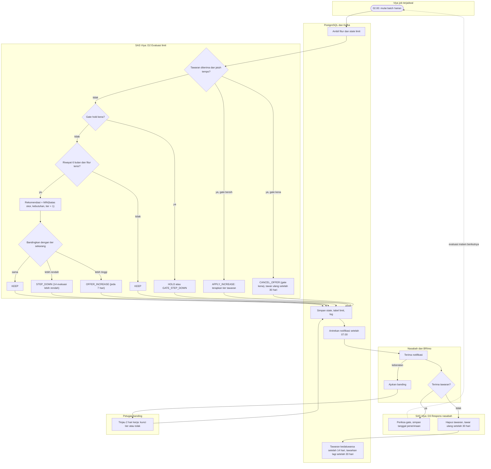

# Diagram proses end-to-end, versi 3 (Viya sebagai pusat keputusan)

Diperbarui 27 Oktober 2026. Diselaraskan dengan [DECISION_FLOWS.md](DECISION_FLOWS.md). Dasar keputusan:
- **PostgreSQL** (kunci CIF) menyimpan semua data dan dapat diakses dari Viya dan Python. Transaksi masuk dan keluar lengkap; enrichment channel (perangkat, kredensial, lokasi) masuk lewat **Kafka**.
- **SAS Viya** adalah satu-satunya yang diketahui middleware (endpoint gateway). Model ada di Viya dan dipanggil dari **Intelligent Decisioning**. Viya mengirim aksi ke channel dan menerima umpan balik nasabah.
- **Python hanya untuk pengembangan model** (latih ulang, ekspor ke Viya) serta oracle uji dan data sintetis.
- Asumsi default nomor 1–12 berlaku ([STORYBOARD.md](STORYBOARD.md) frame 3.12). Hal yang bergantung pada versi Viya ditandai **[cek lab]**.

**Tiga decision dan satu sub-decision** (penamaan lama F1–F8 dipetakan di bawah):
| Nama | Isi | Padanan penamaan lama |
|---|---|---|
| **D1 Fraud verdict** | keputusan transaksi real-time | F1 (dan F8 bila dipanggil ulang saat sinyal) |
| **D2 Evaluasi limit** | evaluasi malam 02.00, termasuk menerapkan tawaran yang jatuh tempo | F2 |
| **D3 Respons nasabah** | umpan balik hold dan step-up, tawaran, self-cap, banding | F3, F4, F5 |
| **Sub-decision Notifikasi** | isi, kanal, dan waktu pesan | F6 |
| Pemantauan dan retrain | job terjadwal, Model Manager, Visual Analytics (bukan decision) | F7 |

## 0. Arsitektur komponen

## 1. Sequence: keputusan transaksi real-time (D1) dengan step-up dan hold

## 2. Sequence: hold dan umpan balik nasabah (D3)

## 3. Sequence: data masuk dan fitur harian

## 4. Sequence: evaluasi limit harian 02.00 (D2)

## 5. Sequence: tawaran, self-cap, banding (D3)

## 6. Sequence: siklus hidup model dan pemantauan

## 7. Activity: transaksi real-time dengan siklus hold (D1 dan D3)

## 8. Activity: evaluasi limit harian dan siklus tawaran (D2 dan D3)

## Status per diagram
| Diagram | Sudah ada | Masih rencana |
|---|---|---|
| 0. Arsitektur | model di Model Manager dan MAS; laporan Visual Analytics; Python (latih, oracle) | Postgres, Kafka, job terjadwal, Workflow Manager, caslib ke Postgres |
| 1. D1 | cetak biru ([INTELLIGENT_DECISIONING_BLUEPRINT.md](INTELLIGENT_DECISIONING_BLUEPRINT.md), [DECISION_FLOWS.md](DECISION_FLOWS.md) bagian 3); D1 dilaporkan sudah dibangun di lab, belum diuji dengan berkas uji kita | membaca fitur dari Postgres di dalam decision **[cek lab]**, menggabungkan transaksi yang diputuskan, aksi ke Kafka |
| 2. D3 hold | logika gate dan verdict | seluruh siklus hold dan kasus fraud; aturan "ini saya tetapi masih high_risk tetap ditahan" adalah **[asumsi]** |
| 3. Data dan fitur | rumus fitur dan oracle paritas di Python | sink Kafka, agregator, job fitur di Viya |
| 4. D2 | logika kebijakan di Python (`limit/policy.py`), rule set terinci di DECISION_FLOWS bagian 4 | decision D2 di Viya; **scorecard dan prakiraan harus dibungkus sebagai model Python (MAS tidak menjalankan DATA step)** |
| 5. D3 tawaran, self-cap, banding | logika di Python | semua di Viya, Workflow Manager |
| 6. Model | impor, uji 25 kasus, publish MAS | persetujuan, monitoring Model Manager, pemicu |
| 7 dan 8. Activity | menggambarkan target | idem |
