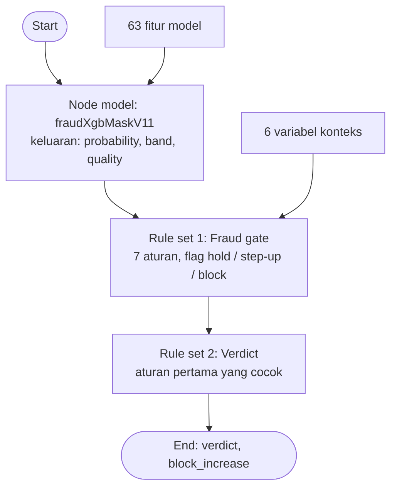

# Cetak biru SAS Intelligent Decisioning: flow "Fraud verdict"

Disusun 27 Oktober 2026. Status: dirancang dan diuji dengan implementasi rujukan di Python. **F1 dilaporkan sudah dibangun di Intelligent Decisioning (27 Okt 2026); belum diverifikasi dengan berkas uji di bawah.** Nama menu di UI bisa berbeda antar versi Viya, jadi langkah di bagian 5 perlu dicek terhadap versi di lab.

Berkas pendukung (semua di [sas_export/decisioning/](../sas_export/decisioning)):
| Berkas | Fungsi |
|---|---|
| `variables.csv` | daftar variabel masukan dan keluaran untuk tab Variables |
| `rules_fraud_gate.csv`, `rules_verdict.csv` | tabel aturan untuk dua rule set |
| `id_test_input.csv`, `id_test_expected.csv` | 43 kasus uji dan hasil yang harus keluar di Viya |
| `decision_flow_ref.py` | implementasi rujukan, pembangkit semua berkas di atas, dan uji kesetaraan dengan backend |

## 1. Apa yang dicakup
Satu keputusan real-time per transaksi: **memutuskan ALLOW, STEP_UP_AUTH, atau HOLD** dan apakah kenaikan limit harus diblokir. Ini padanan dari `POST /score` di backend (jalur 1), dibangun dengan model yang sudah dipublish ke MAS (`fraudxgbmaskv11`) ditambah dua rule set.
**Tidak dicakup:** flow limit harian (scorecard, prakiraan kebutuhan, kebijakan tier). Itu flow kedua; scorecard sudah ada sebagai DATA step (`sas_export/scorecard/scorecard_score.sas`), tetapi prakiraan kebutuhan baru berupa model Python.

## 2. Alur

## 3. Variabel
Daftar lengkap: `variables.csv`. Ringkasan:
- **63 fitur model** (nama sama persis dengan `inputVar.json`; `occupation` dan `segment` bertipe string, sisanya desimal). Nilai kosong dikirim kosong, bukan 0.
- **6 variabel konteks** yang dibutuhkan gate dan tidak dihitung model:
  | Variabel | Arti |
  |---|---|
  | `daily_cap` | batas harian tier nasabah (Rp) |
  | `ftp_large_today` | transfer hari ini ke payee pertama kali dengan nominal > 50% batas |
  | `night_outflow_today` | pengeluaran hari ini pukul 22.00–05.00 (Rp) |
  | `outflow_today` | total pengeluaran hari ini (Rp) |
  | `alerts_30`, `disputes_30` | jumlah alert dan sengketa 30 hari |
- **Keluaran node model:** `EM_EVENTPROBABILITY`, `EM_CLASSIFICATION`, `band`, `quality`.
- **Keluaran flow:** `gate_hold`, `gate_step_up`, `gate_block`, tujuh flag `hit_*`, `verdict`, `block_increase`.

## 4. Rule set
**Rule set 1: Fraud gate** (semua aturan dievaluasi; ambang sama dengan `serving/gate.py` dan proposal §6.3)
| Aturan | Nama | Kondisi | Efek |
|---|---|---|---|
| G1 | FRAUD_SCORE_H | `band = "high_risk"` | hold, block |
| G2 | NEW_DEVICE | `new_device_7 > 0` | block |
| G3 | CREDENTIAL_CHANGE | `cred_change_3 > 0` | block |
| G4 | FIRST_PAYEE_LARGE | `ftp_large_today > 0` | step-up, block |
| G5 | NIGHT_VELOCITY | `night_outflow_today > 0.3 * daily_cap` | step-up, block |
| G6 | OUTFLOW_BALANCE | `(balance + outflow_today) > 50000000 AND outflow_today > 0.5 * (balance + outflow_today)` | step-up, block |
| G7 | OPEN_ALERT_OR_DISPUTE | `alerts_30 > 0 OR disputes_30 > 0` | block |

Tiap aturan yang cocok mengisi `hit_<nama> = 1`, dan flag `gate_hold`, `gate_step_up`, `gate_block` menjadi 1 bila ada aturan yang berefek itu.

**Rule set 2: Verdict** (urut, aturan pertama yang cocok menang)
| Urut | Kondisi | Verdict |
|---|---|---|
| V1 | `gate_hold = 1 OR band = "high_risk"` | HOLD |
| V2 | `gate_step_up = 1 OR band = "suspicious"` | STEP_UP_AUTH |
| V3 | selain itu | ALLOW |

Keluaran tambahan: `block_increase = 1` bila `gate_block = 1` atau `band <> "genuine"`.

## 5. Langkah membangun di Viya (cek nama menu terhadap versi lab)
1. **Build Decisions** → buat decision baru, mis. `Fraud verdict`.
2. **Variables:** tambahkan semua masukan dan keluaran dari `variables.csv` (tipe: Decimal, Integer, String).
3. **Node model:** tambahkan model `fraudXgbMaskV11` dari proyek `sashckton-gearup` di Model Manager, lalu petakan 63 masukan ke variabel decision dengan nama yang sama. *Perlu dicek di lab:* apakah versi Viya mengizinkan model Python sebagai node model. Bila tidak, jalur cadangan: panggil modul MAS lewat code file atau menu *Execute a model published to MAS*.
4. **Rule set 1 dan 2:** buat dari `rules_fraud_gate.csv` dan `rules_verdict.csv`. Atur kebijakan rule set 1 ke "evaluasi semua aturan", rule set 2 ke "berhenti pada kecocokan pertama".
5. **Flow:** Start → node model → Fraud gate → Verdict → End. Validasi flow sampai tanpa galat.
6. **Uji:** unggah `id_test_input.csv` ke CAS (Manage Data, Replace file), buka tab **Scoring** decision, buat tes baru dengan tabel itu, lalu bandingkan keluaran dengan `id_test_expected.csv` (kunci: `case_id`).
7. **Publish** ke tujuan MAS (`maslocal`) setelah semua kasus cocok. Catat nama modul dan titik akhir untuk uji REST.

## 6. Hasil uji yang harus keluar (43 kasus)
- 25 kasus validasi tanpa sinyal konteks: **ALLOW 11, STEP_UP_AUTH 8, HOLD 6** (hanya dari band).
- 10 skenario aturan (`s01`–`s10`), contoh: perangkat baru saja → ALLOW dengan `block_increase = 1`; payee pertama besar, aktivitas malam 40% batas, atau arus-keluar 90 juta vs saldo 80 juta → STEP_UP_AUTH; kasus high_risk ditambah alert → HOLD.
- 6 kasus batas (`b01`–`b06`): tepat 30% batas malam, tepat 50% rasio arus-keluar, dan tepat Rp50 juta saldo-sebelum **tidak** memicu; sedikit di atasnya memicu.
- 2 kasus kualitas rendah (`q01`, `q02`, 70% fitur numerik kosong).
Skor model di `id_test_expected.csv` berasal dari kode skor yang sama dengan modul MAS, jadi harus cocok dalam toleransi 1e-5 (lihat runbook langkah 4).

## 7. Bukti kesetaraan dan temuan
- Tabel aturan cocok dengan gate di backend pada **3.000 baris acak** (fitur dari sampel latih, konteks acak): kode aturan, verdict, dan `block_increase` identik pada seluruh baris. Jalankan ulang: `python sas_export/decisioning/decision_flow_ref.py --check-backend 3000`.
- **Temuan: data kosong lolos begitu saja.** Kasus `q01` (70% fitur kosong, `quality = low`) mendapat band genuine dan verdict **ALLOW**. Itu sama dengan perilaku backend, tetapi runbook sendiri menyatakan bahwa `quality = low` seharusnya jatuh ke aturan deterministik dan bukan diputuskan dari skor saja. Usulan aturan tambahan yang perlu diputuskan tim: `quality = "low" AND verdict = "ALLOW"` → `STEP_UP_AUTH`. Konsekuensinya menambah gesekan bila banyak data kosong, jadi ukur dulu berapa persen transaksi berkualitas rendah di data nyata. Aturan ini sengaja **tidak** dimasukkan ke baseline supaya sama dengan backend.
- **Enam variabel konteks harus disuplai pemanggil.** Viya tidak menghitungnya. Di desain kita, itu tugas feature store atau backend (`ftp_large`, nominal malam, dan seterusnya dari catatan harian hari ini).
- **Semantik nilai kosong di aturan:** di implementasi rujukan, perbandingan dengan nilai kosong bernilai salah (aturan tidak memicu). Di SAS, nilai numerik kosong dianggap lebih kecil dari semua angka, sehingga `x > 0` juga salah. Tetap diuji di lab.

## 8. Terhadap proposal §7
Flow ini hanya mengerjakan bagian gate dan hold pada alur proposal. Bagian "scorecard + forecast → tier → offer/step-down" adalah flow kedua (limit harian) yang belum dibangun.

## 9. Pembaruan arsitektur (27 Oktober 2026)
Keputusan terbaru: middleware hanya mengenal endpoint Viya, dan semua data ada di PostgreSQL (kunci CIF) yang dapat dibaca dari Viya. Dampaknya pada flow ini:
- **Masukan ke F1 berubah.** Middleware tidak lagi mengirim 69 variabel. Ia mengirim **CIF dan transaksi yang diputuskan** (nominal, waktu, payee, kategori). Enam variabel konteks dan 63 fitur diambil dari Postgres (fitur harian dan agregat hari ini, profil, limit). Daftar variabel di `variables.csv` tetap berlaku sebagai **variabel internal decision** dan kolom tabel `features`.
- **Transaksi yang sedang diputuskan** harus digabung dengan fitur hari berjalan sebelum node model (default: langkah penggabungan di F1; uji paritasnya terhadap `serving/store.py` wajib). Cara membaca Postgres dari dalam decision (node query atau lookup, atau code file) **[cek lab]**.
- Berkas uji `id_test_input.csv` dan `id_test_expected.csv` tetap sah untuk menguji node model, rule set gate, dan rule set verdict (dengan 69 variabel sebagai masukan langsung). Untuk uji penuh F1, tambahkan kasus dengan CIF dan transaksi setelah tabel Postgres tersedia.
- F1 bersifat **tanpa state**; penulisan log dan state dilakukan lewat Kafka atau job. Alur lengkap: [DIAGRAMS.md](DIAGRAMS.md) dan [STORYBOARD.md](STORYBOARD.md).
